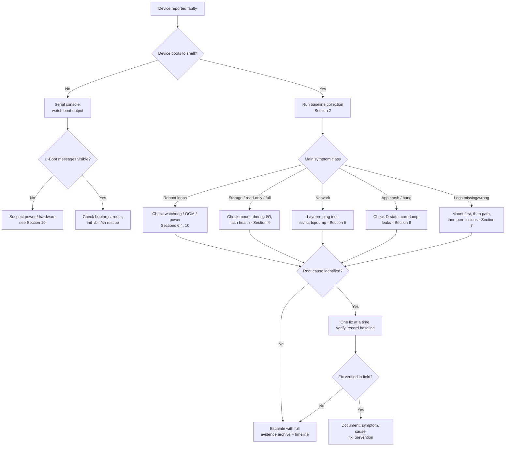

# Embedded Linux Device Troubleshooting Guide

[]()
[]()
[]()
[]()

> **Audience:** R&D engineers and technical support staff
> **Scope:** Linux-based embedded devices (eMMC/NAND/UBIFS storage, BusyBox or standard distro, headless)
> **Golden rule:** *Collect evidence first, modify second. Change one variable at a time. Record before changing, verify after changing.*

---

## Table of Contents

- [1. General Principles](#1-general-principles)
- [2. Baseline Data Collection (Mandatory First Step)](#2-baseline-data-collection-mandatory-first-step)
  - [2.1 One-Shot Evidence Collection Script](#21-one-shot-evidence-collection-script)
  - [2.2 Baseline Command Reference](#22-baseline-command-reference)
  - [2.3 Evidence Handling Rules](#23-evidence-handling-rules)
- [3. Boot Issues](#3-boot-issues)
  - [3.1 Device Won't Boot / Reboot Loops](#31-device-wont-boot--reboot-loops)
  - [3.2 Boot-Loader Stage Debugging (U-Boot)](#32-boot-loader-stage-debugging-u-boot)
  - [3.3 Service Fails to Start](#33-service-fails-to-start)
  - [3.4 Mount Failures](#34-mount-failures)
  - [3.5 Emergency / Rescue Access](#35-emergency--rescue-access)
- [4. Storage Issues (eMMC / NAND / Flash)](#4-storage-issues-emmc--nand--flash)
  - [4.1 Device Identification](#41-device-identification)
  - [4.2 Filesystem Anomalies](#42-filesystem-anomalies)
  - [4.3 Flash Health & Lifetime Management](#43-flash-health--lifetime-management)
- [5. Network Issues](#5-network-issues)
  - [5.1 Connectivity](#51-connectivity)
  - [5.2 Ports and Listeners](#52-ports-and-listeners)
  - [5.3 Packet Capture](#53-packet-capture)
  - [5.4 Common Embedded Network Root Causes](#54-common-embedded-network-root-causes)
  - [5.5 Wireless (Wi-Fi) Specifics](#55-wireless-wi-fi-specifics)
- [6. Process / Service Issues](#6-process--service-issues)
  - [6.1 Abnormal Processes](#61-abnormal-processes)
  - [6.2 Crashes / Restart Loops](#62-crashes--restart-loops)
  - [6.3 Memory Leak Hunting](#63-memory-leak-hunting)
  - [6.4 Watchdog Deep Dive](#64-watchdog-deep-dive)
- [7. Logging Issues (Including Failed Log Downloads)](#7-logging-issues-including-failed-log-downloads)
  - [7.1 The Logging Stack](#71-the-logging-stack)
  - [7.2 Troubleshooting Failed Log Downloads](#72-troubleshooting-failed-log-downloads)
  - [7.3 Log Rotation](#73-log-rotation)
  - [7.4 Persistent Logging Across Reboots](#74-persistent-logging-across-reboots)
- [8. Time & Clock Issues](#8-time--clock-issues)
- [9. Performance Issues](#9-performance-issues)
- [10. Power & Hardware Issues](#10-power--hardware-issues)
- [11. Field Report Checklist](#11-field-report-checklist)
- [12. Troubleshooting Decision Flowchart](#12-troubleshooting-decision-flowchart)
- [13. OTA / A-B Update Failures](#13-ota--a-b-update-failures)
- [14. Device Tree & Driver Issues](#14-device-tree--driver-issues)
- [15. Symptom Quick-Reference Table](#15-symptom-quick-reference-table)
- [16. Common Pitfalls](#16-common-pitfalls)
- [17. Field Toolkit: What to Bring](#17-field-toolkit-what-to-bring)
- [18. Glossary](#18-glossary)
- [19. Further Reading](#19-further-reading)
- [License](#license)

---

## 1. General Principles

1. **Reproduce and collect evidence first.** Capture the full state (see [Section 2](#2-baseline-data-collection-mandatory-first-step)) *before* making any change. Modifications destroy the crime scene — once evidence is lost, it cannot be recovered.
2. **Change one variable at a time.** Changing multiple settings simultaneously makes root-cause isolation impossible. Verify after every change; roll back if verification fails.
3. **Keep a timeline.** When the symptom first appeared, power-loss/reboot events, software versions, configuration changes — 60% of fault localization relies on a good timeline.
4. **No blind operations.** Never casually format, run `fsck`, reflash, or delete files in the field. These are irreversible actions and must be evaluated first.
5. **Pin the version baseline.** Confirm the firmware version, kernel version, and filesystem type. Symptoms across different versions are not directly comparable.
6. **Distinguish facts from hypotheses.** Write down what you *observed* (log lines, LED states, voltage readings) separately from what you *suspect*. Confusing the two leads the whole team astray.
7. **Know your escape hatches before you need them.** Serial console access, bootloader interrupt, rescue shell, backup firmware — verify they work *before* the device is broken.

---

## 2. Baseline Data Collection (Mandatory First Step)

### 2.1 One-Shot Evidence Collection Script

Save this as `collect.sh`, push it to the device, and run it. It bundles everything in [Section 2.2](#22-baseline-command-reference) into a single timestamped archive:

```sh
#!/bin/sh
# Evidence collector for embedded Linux devices — run as root.
# Output: /tmp/evidence_<hostname>_<date>.tar.gz

OUT="/tmp/evidence_$(hostname)_$(date +%Y%m%d_%H%M%S)"
mkdir -p "$OUT"

run() {           # run "description" command args...
    desc="$1"; shift
    echo "===== $desc =====" >> "$OUT/report.txt"
    "$@" >> "$OUT/report.txt" 2>&1
    echo >> "$OUT/report.txt"
}

run "kernel"      uname -a
run "issue"       cat /etc/issue
run "cmdline"     cat /proc/cmdline
run "datetime"    date
run "uptime"      uptime
run "mounts"      mount
run "disk-space"  df -h
run "disk-inodes" df -i
run "memory"      free -m
run "processes"   ps -ef
run "network"     ifconfig -a
run "routes"      ip route 2>/dev/null || route -n
run "listeners"   ss -tlnp 2>/dev/null || netstat -tlnp

# Full kernel ring buffer (most valuable, most perishable evidence)
dmesg > "$OUT/dmesg.txt" 2>&1

# Copies of key proc/sys state
cp /proc/partitions  "$OUT/partitions.txt"   2>/dev/null
cp /proc/interrupts  "$OUT/interrupts.txt"   2>/dev/null
cp /proc/loadavg     "$OUT/loadavg.txt"      2>/dev/null
cp /etc/fstab        "$OUT/fstab.txt"        2>/dev/null
cp /etc/config/*     "$OUT/"                 2>/dev/null

tail -n 500 /var/log/messages > "$OUT/messages_tail.txt" 2>/dev/null

tar -czf "$OUT.tar.gz" -C /tmp "$(basename "$OUT")"
echo "Done: $OUT.tar.gz"
echo "Pull it with: scp root@<device>:$OUT.tar.gz ."
```

> **Tip:** BusyBox `sh` is sufficient — no bash required. Adjust the `/etc/config/*` and `/var/log/messages` paths to match your platform.

### 2.2 Baseline Command Reference

If you cannot push the script, run these manually via SSH or serial console and **save the full output**:

```sh
uname -a                    # Kernel version
cat /etc/issue              # Distro / firmware version
cat /proc/cmdline           # Kernel boot parameters
date                        # Current time (check RTC / timezone issues)
uptime                      # Uptime (check for frequent reboots)
dmesg                       # Kernel log (check both head and tail)
mount                       # All mount points
df -h && df -i              # Disk space and inodes
free -m                     # Memory
ps -ef                      # Process list
ifconfig -a                 # Network interfaces (or: ip addr)
```

| Command | What it answers |
| --- | --- |
| `uname -a` | Which kernel is *actually* running? |
| `cat /proc/cmdline` | How was the kernel booted (console, root, mount flags)? |
| `uptime` | Has the device been unstable since boot, or for weeks? |
| `dmesg` \| `tail` | What did the kernel complain about last? |
| `df -h && df -i` | Full disk? Or inode exhaustion (plenty of space, no files possible)? |
| `free -m` | Is the "available" column (not "free") healthy? |
| `mount` | Anything mounted `ro` that should be `rw`? |

> **Warning:** The `dmesg` ring buffer gets overwritten after boot. Capture it as soon as possible at a fault site — old `dmesg` output is lost forever after a reboot.

### 2.3 Evidence Handling Rules

- **Never paste evidence into chat apps.** Plain-text formatting destroys log line breaks; use file attachments or a snippet tool.
- **Timestamp everything.** If the device clock is wrong, note the offset: `echo "device clock offset: $(date)"`.
- **Keep originals read-only.** Analyze copies; never edit the raw capture.
- **One archive per incident.** Don't mix captures from different days or devices in the same folder.

---

## 3. Boot Issues

### 3.1 Device Won't Boot / Reboot Loops

```sh
dmesg | tail -50
cat /proc/cmdline
```

| Symptom | Direction |
| --- | --- |
| Kernel panic / oops | Capture the full panic stack; record the last 20 lines |
| Hangs at a specific boot stage | Map against the boot sequence; identify the stuck service/mount |
| Periodic reboots | Check watchdog, hardware reset, memory issues |

Kernel panic essentials — when you capture one, make sure you have:

```text
[  123.456] Unable to handle kernel NULL pointer dereference at ...
[  123.456] PC is at my_driver_probe+0x2c/0x58
[  123.456] LR is at ...
...call trace...
[  123.460] ---[ end trace 0000000000000000 ]---
```

- `PC is at <func>+<offset>/<size>` → the faulting function; resolve with `addr2line` or the System.map of the *exact* kernel build.
- The **call trace** is the stack; the first few frames usually identify the culprit driver.
- `pid: N, comm: <name>` → which process triggered it.
- If the trace scrolls off the console, enable the **panic-on-oops pause** (`kernel.panic` sysctl) or use a serial console with logging (see [Section 10](#10-power--hardware-issues)).

### 3.2 Boot-Loader Stage Debugging (U-Boot)

If nothing reaches the kernel at all (`dmesg` empty, no console output), the problem is in the boot loader:

1. **Interrupt the autoboot:** press a key (usually any key, or `Ctrl+C`) during the countdown.
2. **Inspect the environment:**
   ```text
   printenv bootcmd bootargs mmcargs
   printenv bootdelay stdout stderr
   ```
3. **Check what the kernel command line will be:** `bootargs` should contain a valid `root=`, `console=`, and filesystem type matching your image.
4. **Probe the storage:** `mmc dev 0; mmc info` — verify size, bus width, and that the eMMC responds at all.
5. **Useful escapes:**
   - Boot into a shell directly: `setenv bootargs "${bootargs} init=/bin/sh"` (kernel runs `/bin/sh` instead of init — great for repairing fstab/init scripts).
   - Increase verbosity: append `initcall_debug` to `bootargs` to print every init call with timing.
   - `bootdelay=-1` (or an interrupted autoboot) gives you an indefinite window to work in.

> **Caution:** `saveenv` persists changes across reboots. Experiment freely in RAM, but think twice before saving.

### 3.3 Service Fails to Start

- **systemd devices:**
  ```sh
  systemctl status <service>
  journalctl -u <service> -n 50 --no-pager
  systemctl list-jobs              # what is stuck/waiting
  systemd-analyze blame            # slowest units at boot
  ```
- **BusyBox / SysV init devices:** inspect scripts under `/etc/init.d/`, run them manually to see the error:
  ```sh
  sh -x /etc/init.d/S99myapp start   # -x traces every line
  ```
- **Classic init ordering bug:** the service starts *before* the network or mount it depends on. Check `After=`/`Requires=` in the unit file, or the script numbering in `/etc/init.d/` (`S20net → S99app`).

### 3.4 Mount Failures

Very common on embedded devices:

```sh
mount | grep -E "rootfs|ubi|mmc|overlay"
cat /etc/fstab
```

- **Read-only rootfs:** UBIFS/UBI mounted read-only, or a read-only overlay layer. `mount -o remount,rw` is only a temporary workaround — the root cause lies in `fstab` or kernel boot parameters.
- **External storage fails to mount:** *Applications must check the return value of mount operations.* Otherwise they will read data from the wrong path — this is a classic root cause of "log download failed" reports.
- **USB/SD hot-plug races:** device nodes appear asynchronously (`/dev/sda1` may not exist yet when your script runs). Use `udev` rules or poll for the node; never assume a fixed `sdX` name.

### 3.5 Emergency / Rescue Access

When normal boot fails, know these entry points (verify them **before** you need them):

| Access method | How | Use when |
| --- | --- | --- |
| Serial console | Connect UART; watch full boot log | Any boot problem — always your first tool |
| U-Boot `init=/bin/sh` | Modify `bootargs` | rootfs OK but init/services broken |
| U-Boot single-user | Append `single` to `bootargs` | systemd/distro maintenance mode |
| Alternate rootfs partition | `printenv` / change `root=` | A/B update schemes — boot the other slot |
| `rdinit=/bin/sh` | Ramdisk shell | rootfs itself is corrupt |

---

## 4. Storage Issues (eMMC / NAND / Flash)

### 4.1 Device Identification

```sh
lsblk -f                    # Block devices and filesystems
cat /proc/partitions        # Partition table
ls /sys/block/              # Device nodes
cat /sys/block/mmcblk0/size # eMMC capacity (in sectors)
```

Extra identification that pays off:

```sh
cat /sys/block/mmcblk0/device/type      # MMC or SD
cat /sys/block/mmcblk0/device/manid     # Manufacturer ID
cat /sys/block/mmcblk0/device/name      # Chip name string
cat /sys/block/mmcblk0/device/csd       # Card Specific Data register
ls /sys/class/mtd/                      # NAND/MTD partitions (mtd0, mtd1...)
cat /proc/mtd                           # MTD partition map
```

### 4.2 Filesystem Anomalies

```sh
dmesg | grep -iE "mmc|nand|ubifs|i/o error|timeout|reset|read-only"
df -h /mountpoint && df -i /mountpoint
```

| Symptom | Diagnosis | Action |
| --- | --- | --- |
| Mounted as `(ro,...)` / `errors=remount-ro` | Filesystem error triggered auto read-only | Capture `dmesg` first, evaluate, then `fsck` |
| Usage at 100% / inodes exhausted | Disk full | Clean up logs/temp files; check rotation config |
| Many I/O errors / timeouts in `dmesg` | Hardware or bad contact | Check card slot/ribbon cable; replace storage if needed |
| Sudden capacity loss / corrupted files | Flash medium wearing out | Record bad blocks and SMART info; plan replacement |
| Works when cold, fails when hot | Thermal or voltage margin on flash | Correlate with temperature logs; see [Section 10](#10-power--hardware-issues) |

> **Caution:** `fsck` is a destructive operation. On embedded devices it must be run during a maintenance window with the device stopped, and only after backing up data (when possible) — then `fsck -y`. For UBIFS, prefer `ubidetach`/`ubiattach` health checks over blind repair; UBIFS is wear-leveled and journaling, so "repairing" a detached volume can do more harm than good.

**Filesystem choice cheat sheet** (for review when designing, or interpreting a broken device):

| Filesystem | Flash type | Notes |
| --- | --- | --- |
| ext4 | eMMC (FTL inside chip) | Robust, journaling; default for eMMC rootfs |
| UBIFS | raw NAND over UBI | Wear-leveling, power-cut resilient — handle with UBI tools only |
| SquashFS | any (read-only) | Immutable, power-safe; pair with overlay for /etc & /var |
| F2FS | eMMC/SD | Flash-friendly; check kernel version maturity |
| FAT32 / exFAT | SD/USB removable | Interop only — never for logs or databases |

### 4.3 Flash Health & Lifetime Management

Flash wears out. Devices that "fail after 2 years in the field" are often write-amplification victims:

```sh
# eMMC life-time estimate (0x01-0x0A normal, above = worn)
cat /sys/block/mmcblk0/device/life_time
# Pre-EOL info: 0x01 normal, 0x02 warning, 0x03 urgent
cat /sys/block/mmcblk0/device/pre_eol_info

# UBI eraseblock health
cat /sys/class/ubi/ubi0/*/bad_peb_count 2>/dev/null

# Who is writing? (snapshot twice, 60s apart, compare)
grep -H '' /proc/[0-9]*/io 2>/dev/null | grep write_bytes | sort -t: -k3 -n | tail
```

Write-reduction checklist for firmware design:

- Mount with `noatime` (avoid access-time writes on every read);
- Redirect `/tmp` and logs to RAM (`tmpfs`) where volatility is acceptable;
- Never log in a tight loop to flash; batch and flush;
- Set sane logrotate size/retention (see [Section 7.3](#73-log-rotation));
- Beware of databases: SQLite in default mode does many small writes — enable WAL or move to tmpfs.

---

## 5. Network Issues

### 5.1 Connectivity

```sh
ping -c 4 <peer-ip>
ip route                    # Routing table
arp -n                      # Neighbor table
```

Layer-by-layer quick test:

```sh
ping 127.0.0.1        # TCP/IP stack alive?
ping <gateway>        # Local subnet reachable?
ping 8.8.8.8          # Internet reachable (IP level)?
ping google.com       # DNS working?
```

Each failing step points to a different layer: stack → link/LAN → routing → DNS.

### 5.2 Ports and Listeners

```sh
ss -tlnp                    # Listening ports (netstat -tlnp also works)
nc -vz <ip> <port>          # Test port connectivity
```

Common interpretation of `ss -tlnp` output:

| What you see | Meaning |
| --- | --- |
| No line for your port | Application not listening — check the app |
| `127.0.0.1:8080` only | Bound to loopback — unreachable from outside; bind `0.0.0.0` |
| `LISTEN` present, `nc` fails | Firewall or routing in the path |
| `SYN-RECV` / stuck states | Half-open connections; backlog or app not accepting |

### 5.3 Packet Capture

For "connected but not working" cases:

```sh
tcpdump -i eth0 -nn -s0 host <ip> -w /tmp/cap.pcap
# Quick on-screen view without a file:
tcpdump -i eth0 -nn port 443
```

Analyze the `.pcap` in Wireshark on your PC. What to look for:

- **TCP retransmissions / DUP ACKs** → lossy link, bad cable, duplex mismatch;
- **ICMP host unreachable** → routing problem somewhere in the path;
- **RST immediately after SYN** → port closed or firewall actively rejecting;
- **TLS handshake failure** → wrong time/clock (see [Section 8](#8-time--clock-issues)) or bad certificate.

> **Tip:** No `tcpdump` on the device? BusyBox may lack it. Keep a **statically linked** `busybox` + `tcpdump` binary on your laptop ready to `scp` over — the target's glibc version becomes irrelevant.

### 5.4 Common Embedded Network Root Causes

| Symptom | Direction |
| --- | --- |
| Interface has no IP | DHCP failure, cable/PHY issue, `ifconfig eth0 up` never executed |
| Ping works but application doesn't | Port not listening, firewall/iptables, app bound to wrong address |
| WAN unreachable, LAN works | Routing, DNS, gateway |
| Intermittent connectivity | Cable contact, duplex negotiation, insufficient power |
| Link up, no traffic passes at all | MAC/PHY mismatch, VLAN misconfig, MAC filtering upstream |
| Works for hours, then dies | DHCP lease not renewed — check lease time and renewal logic |

### 5.5 Wireless (Wi-Fi) Specifics

```sh
iw dev                      # Interface state
iw dev wlan0 link           # Current association, signal strength
iwlist wlan0 scan | grep -E "ESSID|Quality"   # BusyBox alternative
```

| Observation | Meaning |
| --- | --- |
| Signal < -70 dBm | Weak signal — expect drops and retries |
| Frequent disconnect/reconnect in logs | Interference, roaming, or power-save (PSM) issues |
| `link` shows no AP | Association failing — check credentials, band, regulatory domain |

Embedded Wi-Fi modules are also power-hungry: TX bursts on a weak supply can brown out the whole SoC (see [Section 10](#10-power--hardware-issues)).

---

## 6. Process / Service Issues

### 6.1 Abnormal Processes

```sh
ps -ef | grep <process>
top -d 2                    # Watch CPU/memory usage
cat /proc/<pid>/status      # Per-process resource details
cat /proc/<pid>/wchan       # What is the kernel waiting on? (blocking ops)
ls -l /proc/<pid>/fd        # Open file descriptors
cat /proc/<pid>/maps        # Memory map
```

Process state letters in `ps` output decoded:

| State | Meaning | Typical implication |
| --- | --- | --- |
| `R` | Running / runnable | CPU-hungry if persistent |
| `S` | Sleeping (wait for event) | Normal |
| `D` | Uninterruptible sleep | Usually **I/O** — stuck storage or NFS; a smoking gun for flash issues |
| `Z` | Zombie | Parent not reaping — check parent logic |
| `T` | Stopped | Someone sent SIGSTOP, or debugger attached |

> **`D` state is special:** it usually means the process is blocked in the kernel on storage I/O. Many `D` processes + I/O errors in `dmesg` = storage hardware problem, not an application bug.

### 6.2 Crashes / Restart Loops

- Check coredump configuration, then locate the dump file:
  ```sh
  cat /proc/sys/kernel/core_pattern
  ulimit -c            # 0 means cores are disabled
  ```
- Check logs: `dmesg | grep -iE "segfault|oops|watchdog|killed"`;
- Check whether a hardware watchdog is resetting the board: `ls /dev/watchdog*`;
- Check for OOM kills: `dmesg | grep -i "out of memory"`.

Reading a segfault line:

```text
myapp[1234]: segfault at 0 ip 0000000000401a2e sp 00007ffd error 4 in myapp[400000+2a000]
```

- `segfault at 0` → NULL pointer dereference (address 0);
- `ip <addr>` → instruction pointer; resolve with `addr2line -e myapp 0x401a2e`;
- `error 4` → user-mode read of an unmapped address;
- If enabled, load the coredump in GDB: `gdb myapp core` then `bt`.

Reading an OOM kill:

```text
Out of memory: Killed process 1234 (myapp) total-vm:512000kB, ...
```

- The OOM killer reports the memory hogs in the same block — the *victim* is not always the *culprit*. Look for the process with the largest `total-vm`/RSS in that dump.

### 6.3 Memory Leak Hunting

Confirm first, then localize:

```sh
# 1) Watch RSS of a suspect over time (every 60s, 10 samples)
while :; do grep VmRSS /proc/<pid>/status; sleep 60; done | tee rss.log

# 2) System-wide memory breakdown
cat /proc/meminfo          # compare MemAvailable, Cached, Slab
smem -t -k 2>/dev/null     # if available: proportional set size per process

# 3) Kernel memory (leaks can live in the kernel too)
cat /proc/slabinfo | head -30
```

Interpreting the trend:

| Pattern | Likely cause |
| --- | --- |
| RSS grows steadily, never plateaus | Application leak — use Valgrind/ASan on the dev unit |
| RSS grows then plateaus | Cache/pool warm-up — usually fine; compare with earlier baseline |
| `Slab` grows, no process grows | Kernel leak (driver) — check `/proc/slabinfo` deltas |
| `MemAvailable` drops while `Cached` grows | Page cache reclaiming works; often not a leak at all |

> **Tip:** On a development unit, run `valgrind --leak-check=full ./myapp` or build with `-fsanitize=address`. On the target in the field, you can only *confirm* the leak — *localizing* it requires the lab.

### 6.4 Watchdog Deep Dive

Watchdogs are the #1 cause of "mysterious periodic reboots". Divide and conquer:

```sh
ls /dev/watchdog*                  # Hardware WDT present?
cat /proc/sys/kernel/hung_task_timeout_secs 2>/dev/null  # Kernel hung-task (soft) watchdog
dmesg | grep -iE "watchdog: BUG|soft lockup|hard lockup"
systemctl list-units | grep -i watchdog   # systemd watchdog services
```

| Reset type | Signature in logs | Meaning |
| --- | --- | --- |
| Hardware WDT reset | **No log at all** — device just reboots | App stopped kicking `/dev/watchdog`, or kernel hung hard |
| Soft lockup | `watchdog: BUG: soft lockup - cpu#0 stuck for 22s` | Kernel loop with interrupts enabled |
| Hard lockup | `NMI watchdog: Watchdog detected hard LOCKUP` | Interrupts disabled too long / NMI watchdog |
| Hung task | `INFO: task X blocked for more than 120 seconds` | Task stuck on I/O or a lock |

The distinguishing feature: **hardware watchdog resets leave no final log line** — that silence is itself evidence. Correlate the reset timestamps with your timeline: a fixed period (e.g., exactly every 60s) points to a WDT timeout value; random intervals point to power or thermal.

---

## 7. Logging Issues (Including Failed Log Downloads)

### 7.1 The Logging Stack

- **dmesg:** kernel ring buffer (overwritten after boot, lost on power-off);
- **syslog:** userspace logging, configured in `/etc/syslog.conf` or `/etc/rsyslog.d/`;
- **Application logs:** written by the app itself, commonly in `/var/log`, `/mnt/card`, `/tmp`.

Understand the persistence of each layer before trusting it:

| Layer | Survives reboot? | Survives power-cut? | Best for |
| --- | --- | --- | --- |
| `dmesg` (RAM ring) | No (unless `pstore`/`dmesg -s` saved) | No | Live kernel state |
| syslog on rootfs | Yes (if flushed) | Journal may lose the tail | Service/startup issues |
| App logs on SD/eMMC | Yes | Last buffered bytes may be lost | Long-term field evidence |

### 7.2 Troubleshooting Failed Log Downloads

High-frequency scenario — follow this exact order:

```sh
# 1) Does the file exist?
ls -l <log-path>

# 2) Is the storage mounted? (when logs live on external storage)
mount | grep <storage>

# 3) Permissions
ls -ld <log-dir>
id <running-user>

# 4) Is the application actually writing?
ps -ef | grep <log-process>
```

| Check fails with | Then |
| --- | --- |
| `ls: No such file or directory` | Wrong path in config, or storage not mounted at expected point (go to check 2) |
| `mount` shows nothing for the card | Mount failed — see [Section 3.4](#34-mount-failures); then check card presence in `/sys/block` |
| `Permission denied` | Fix ownership/permissions; ask *why* they were wrong (umask? init order?) |
| Process not running | App crashed — check its own error output first (see [Section 6.2](#62-crashes--restart-loops)) |

> **Classic pitfall:** *Logs are on an eMMC/SD card; the card is not mounted or the mount point differs from expectations → the program can't read the file → the download reports "file not found".* **Check the mount first, then the file, then permissions.**

### 7.3 Log Rotation

```sh
cat /etc/logrotate.conf /etc/logrotate.d/* 2>/dev/null
ls -l /var/log/ | head
```

- **No rotation** → disk fills up (check `df -h`);
- **Rotation too aggressive** → logs around the failure moment were already overwritten (review the rotation period/retention count; consider increasing them).

BusyBox-only devices often lack `logrotate` entirely. Minimal replacement via `crontab`:

```sh
# Rotate at 4 MB, keep 3 generations
0 * * * * [ -f /var/log/app.log ] && [ $(stat -c%s /var/log/app.log) -gt 4194304 ] && { \
  mv /var/log/app.log.2 /var/log/app.log.3 2>/dev/null; \
  mv /var/log/app.log.1 /var/log/app.log.2 2>/dev/null; \
  mv /var/log/app.log /var/log/app.log.1; } 
```

Sane starting point for embedded devices: `size 4M`, `rotate 3`, `compress` — tune by how long the longest expected failure-to-report window is.

### 7.4 Persistent Logging Across Reboots

If the device reboots before you can look at it, you need logging that survives:

- **pstore/ramoops** (kernel oops/panic persistence):
  ```sh
  ls /sys/fs/pstore/          # after a crash+reboot, oops logs appear here
  mount | grep pstore
  ```
  Enable via kernel config + reserved-RAM device tree node; this is the *only* way to capture the final kernel words before a panic reboot.
- **syslog to persistent rootfs:** ensure `/var/log` is *not* on tmpfs, or explicitly log to a persistent path;
- **Remote syslog** (best for fleets): forward to a central collector:
  ```sh
  # rsyslog: forward everything to the log server
  echo "*.* @192.168.1.10:514" >> /etc/rsyslog.d/60-remote.conf
  # busybox syslogd alternative:
  syslogd -R 192.168.1.10
  ```

---

## 8. Time & Clock Issues

```sh
date
cat /proc/driver/rtc
hwclock -r                  # Hardware clock
```

| Symptom | Impact | Action |
| --- | --- | --- |
| RTC drifts | Scrambled log timestamps, certificate validation failures | Check RTC battery; enable NTP sync |
| Wrong timezone | Log times offset by hours from local time | Check `/etc/localtime` and the `TZ` environment variable |
| Time lost on power-off | No RTC battery, or RTC not initialized | Restore time in a boot script |
| Correct time, wrong year | Year register overflow or epoch handling bug | Check RTC driver and `hwclock` year handling |
| TLS/HTTPS randomly fails | Cert "not yet valid" after each boot | Boot-time clock is behind real time — sync NTP before first TLS use |

Why this matters more on embedded than on servers: a device booting with clock = 1970-01-01 will (a) write garbage timestamps into logs, (b) fail certificate validation for any HTTPS/NTP-over-TLS, and (c) corrupt rotation/retention logic that compares file times. **Sync time before anything network-critical runs.**

Quick NTP sanity check:

```sh
ntpq -p 2>/dev/null || cat /var/run/ntpd.pid 2>/dev/null   # full ntpd
# BusyBox:
ntpd -q -p pool.ntp.org      # one-shot query-and-set
date; sleep 1; date          # is the clock even advancing at the right rate?
```

---

## 9. Performance Issues

```sh
top -d 2
cat /proc/loadavg
free -m
iostat -x 2                 # I/O statistics (if available)
vmstat 2 5                  # CPU/IO/memory balance in one screen
```

| Metric | Warning sign |
| --- | --- |
| Load > CPU core count, sustained | A process is saturating CPU, or high I/O wait |
| Memory keeps growing | Memory leak — watch RSS trends (see [6.3](#63-memory-leak-hunting)) |
| High I/O wait + I/O errors in `dmesg` | Storage hardware problem |
| Single core pegged at 100% | Infinite loop / interrupt storm |

`vmstat` at a glance (the five columns that matter):

```text
procs -----------memory---------- ---swap-- -----io---- -system-- -----cpu-----
 r  b         swpd   free   buff  cache   si   so    bi    bo   in   cs us sy id wa
 1  5            0  12000  40000 180000    0    0  2500     0 900 4000 15 25  5 55
```

| Field | Healthy | Alarm |
| --- | --- | --- |
| `r` (runnable) | ≲ core count | Persistently > cores = CPU starvation |
| `b` (blocked on I/O) | ~0 | Persistently high = storage bottleneck |
| `si`/`so` (swap in/out) | 0 | Any sustained value = RAM exhausted |
| `wa` (I/O wait) | < 5% | > 25% = the disk is the problem, not the CPU |
| `cs` (context switches) | Stable | Wild oscillation = threading design issue |

> **Embedded note:** many devices ship with swap disabled — so `si/so` will always read 0. In that case, watch `MemAvailable` in `/proc/meminfo` instead: the OOM killer is the next stop after it hits zero.

---

## 10. Power & Hardware Issues

Software looks guilty far more often than it is. When software evidence is contradictory or absent, suspect the physics:

| Symptom | Hardware suspect | How to check |
| --- | --- | --- |
| Reboots under load (radio TX, disk writes, camera on) | Power supply can't handle current spikes | Multimeter on the rail during the spike; scope if available |
| Random corruption after power-cut | Brown-out during flash write | Check for a power-fail warning input / graceful shutdown logic |
| Fails only in cold weather / hot summer | Temperature margin on SoC, flash, or crystal | Correlate failure time with ambient temperature |
| Works on bench, fails in field | Grounding, longer cable runs, EMI | Reproduce with the field cabling, not the bench setup |
| UART console shows garbage | Baud rate mismatch, or *supply ripple* (a noisy rail corrupts UART too) | Verify baud; then suspect power |

Serial console as a debugging lifeline:

- Connect **before** the device fails, and log everything to a file (e.g., `picocom -b 115200 --logfile session.txt /dev/ttyUSB0`);
- The serial console is your *only* witness to early boot and hard-crash output;
- If the device "dies silently," a serial log that just **stops mid-line** is strong evidence of a hardware reset or brown-out — no software crash looks like that.

Field measurement checklist (get these into the report when hardware is suspected):

1. Supply voltage at the device terminals (not at the PSU) — under load;
2. Ambient/enclosure temperature;
3. Cable lengths and types vs. bench setup;
4. Photos of connectors, corrosion, cable routing.

---

## 11. Field Report Checklist

After following this guide, field personnel should report back:

1. The **complete output** (or photos) of the baseline commands in [Section 2](#2-baseline-data-collection-mandatory-first-step) — the `collect.sh` archive is ideal;
2. The relevant `dmesg` excerpts for the problem module (boot / storage / network / process);
3. A **timeline** of failure and recovery events (power loss, reboots, operator actions);
4. Firmware version, device name/location, and photos of the site;
5. Every command executed and its result (needed for elimination reasoning);
6. Environmental notes: temperature, power source, cable setup, weather if outdoor.

> Reports must contain **raw output**, not verbal descriptions. The real information in logs is far more reliable than any second-hand account.

---

## 12. Troubleshooting Decision Flowchart



---

## 13. OTA / A-B Update Failures

Fail-safe updates use two firmware slots: one active, one standby. When an update "fails", there are three distinct failure classes — identify which one you have before touching anything:

1. **Update never installed** (download/verification failed);
2. **Update installed but the device won't boot the new slot** (rollback loop);
3. **Update installed, boots, but is functionally broken** (regression).

### 13.1 What to check, in order

```sh
# Which slot is active? (mechanism varies by platform — examples)
cat /proc/cmdline | grep -oE "root=/dev/[a-z0-9]*"    # which root partition booted
fw_printenv upgrade_available boot_slot bootcount 2>/dev/null   # U-Boot env (RAUC-style)
cat /data/rauc.slot.status 2>/dev/null                 # RAUC
swupdate -l 2>/dev/null; cat /var/log/swupdate.log 2>/dev/null  # SWUpdate
```

### 13.2 Failure signatures and actions

| Signature | Meaning | Action |
| --- | --- | --- |
| Download dies mid-transfer | Network/power — not an update bug | Check connectivity logs; resume support? |
| "Signature/checksum mismatch" | Corrupted image or wrong key | Re-download; verify SHA256 locally first |
| `bootcount` keeps rising, `altbootcmd` firing | New slot fails to boot → bootloader rolling back | Capture the *new slot's* console log via serial — the only way to see why |
| Device boots old firmware after "successful" update | Slot switch flag never set (env not saved, or app forgot `fw_setenv`) | Audit the slot-switch sequence; check `saveenv` persistence |
| Both slots broken | Double failure — power cut during slot erase | Reflash via serial/recovery — this is why recovery mode must exist |

### 13.3 Update-specific design checks (post-mortem angle)

- **Power-cut safety:** writing the *standby* slot is safe; writing the *bootloader itself* is the dangerous moment. Never interrupt bootloader updates.
- **Atomic slot switch:** the "switch to new slot" flag must be committed *after* the image is fully verified — never after merely finishing the write.
- **Boot success criteria:** define what "the new slot is good" means (a service marks itself healthy after N minutes); otherwise a broken new slot boots forever.
- **Rollback budget:** limit retries (U-Boot `bootlimit`) so a bad slot falls back after e.g. 3 attempts instead of bricking the device.
- **Same evidence rules apply:** an update failing in the field needs the update *service log* + `bootcount` history + timeline — not "the update doesn't work".

> **Tip:** Before mass rollout, always test the **rollback path** on a lab unit (kill power during install, corrupt the new slot deliberately). A/B schemes that were never tested failing *are not* fail-safe.

---

## 14. Device Tree & Driver Issues

Symptoms: peripheral invisible, device present but non-functional, probe errors in `dmesg`. The kernel's view of hardware comes from the **device tree (DTB)** + drivers — check both.

### 14.1 First: is the device even seen by the kernel?

```sh
dmesg | grep -iE "probe|deferral|fail|error" | head -30
ls /sys/bus/i2c/devices/      # I2C devices detected (e.g., 1-0050 = bus 1, addr 0x50)
ls /sys/bus/spi/devices/      # SPI devices
cat /proc/interrupts          # IRQ firing counts (two snapshots, compare deltas)
```

Key `dmesg` signatures:

| dmesg line | Meaning | Direction |
| --- | --- | --- |
| `...: failed to get ... (-EPROBE_DEFER)` | Dependency (clock/regulator/gpio) not ready yet | Usually self-resolves; persistent deferral = missing dependency driver |
| `...: probe failed with error -22` (-EINVAL) | Driver rejected the DT data | DT node mismatch vs driver expectations |
| `...: timeout waiting for ...` | Hardware not responding on the bus | Wiring/address/power — check I2C address (hex, 7-bit), pull-ups |
| `i2c i2c-1: ack error` / `-121 (EREMOTEIO) | I2C device not acking | Wrong address, device off, broken trace |
| Nothing at all about the device | Node missing, disabled (`status="disabled"`), or driver not built | Check DT and kernel config |

### 14.2 Inspecting the live device tree

The DTB actually used at boot is exposed in sysfs — compare *that*, not your source `.dts` (they can differ if the wrong DTB was flashed):

```sh
ls /proc/device-tree/                 # root of the live DT
cat /proc/device-tree/model           # confirms WHICH board description booted
ls /proc/device-tree/soc/i2c@*/      # peripherals under a controller node
cat /proc/device-tree/<node>/status   # "okay" or "disabled"
# Dump the whole live tree for offline diff:
dtc -I fs -O dts /proc/device-tree > live.dts    # needs dtc on target (or copy the dir)
```

Compare `live.dts` against the intended `.dts`: the most common field bugs are wrong `reg` (I2C address), missing `pinctrl` (pin muxed to another function), wrong `compatible` string (driver won't bind), and `status = "disabled"` left in.

### 14.3 Driver binding checks

```sh
# Is a driver bound to the device?  (driver -> symlink exists = bound)
ls -l /sys/bus/i2c/devices/1-0050/driver 2>/dev/null

# Which drivers are loaded? (built-in ones won't appear in lsmod)
lsmod

# Kernel config sanity (what's actually compiled in?)
zcat /proc/config.gz 2>/dev/null | grep -i <CONFIG_NAME>
```

| Situation | Meaning |
| --- | --- |
| Device node exists, no `driver` symlink | No matching driver — wrong `compatible` string or driver not built/loaded |
| `driver` symlink present, still broken | Driver bound but misconfigured — check DT properties against the driver docs |
| Works in one kernel version, breaks in another | DT binding changed — check `Documentation/devicetree/bindings` for the driver |

### 14.4 Common root causes ranked by frequency

1. **Pin muxing conflict** — two nodes claim the same pad; second silently loses or errors in `dmesg`;
2. **Wrong I2C address / bus number in DT** — device node on bus 1, hardware wired to bus 2;
3. **`compatible` string typo** — driver matches by exact string, no error is printed;
4. **Missing clocks/regulators** — probe defers forever, looks like "driver doesn't work";
5. **Driver built as module but nothing loads it** — add to `/etc/modules` or build in;
6. **Interrupt edge/level mismatch** — device "works" but fires continuously or never.

> **Workflow tip:** the fastest DT debug loop is `dtc` compile on the host → replace the DTB via U-Boot TFTP → boot → check `dmesg`. Avoid iterating by reflashing the whole firmware image.

---

## 15. Symptom Quick-Reference Table

| Symptom | First commands | Common root causes |
| --- | --- | --- |
| Won't boot | `dmesg \| tail -50` | Kernel panic, mount failure, hardware |
| Reboot loop | `dmesg \| grep -iE "watchdog\|panic"` | Watchdog, memory, power supply |
| Log download says "file not found" | `mount \| grep <storage>` → `ls -l <path>` | Storage not mounted, wrong path, permissions |
| Disk read-only | `mount` (look for `ro`) | Filesystem error triggered auto read-only |
| Disk full | `df -h`, `df -i` | No log rotation, temp file buildup |
| I/O errors | `dmesg \| grep -i "i/o error"` | Hardware, bad contact |
| No network | `ifconfig -a` → `ping` → `ip route` | Interface down, DHCP failure, routing |
| Port unreachable | `ss -tlnp` → `nc -vz` | Not listening, firewall, wrong bind address |
| Service crashes | `dmesg \| grep -iE "segfault\|killed"` | Null pointer, out of memory |
| Wrong log timestamps | `date`, `hwclock -r` | RTC / timezone / NTP |
| Many processes in `D` state | `ps -ef`, `dmesg \| grep -i "i/o"` | Storage hardware hang |
| Slow, but CPU idle | `vmstat 2` (check `wa`) | I/O-bound: failing flash or thrashing |
| Crashes only in the field | Serial log + voltage check | Power margin, EMI, temperature |
| Wi-Fi keeps dropping | `iw dev wlan0 link` | Weak signal, interference, power save |
| Update installs but device reboots to old firmware | `fw_printenv bootcount boot_slot`, update-service log | Slot-switch flag not committed (see [13](#13-ota--a-b-update-failures)) |
| Peripheral invisible to OS | `dmesg \| grep -i probe`, `ls /sys/bus/i2c/devices/` | DT node wrong/disabled, driver not bound (see [14](#14-device-tree--driver-issues)) |
| I2C device not acking | `dmesg \| grep -i "i2c"` | Wrong address, missing pull-ups, device unpowered |

---

## 16. Common Pitfalls

1. **Rebooting or reflashing right away.** This destroys the evidence state — you lose `dmesg` and filesystem state. Collect evidence first.
2. **Treating `dmesg` as the whole story.** `dmesg` is the *kernel* log. For application problems, check syslog and application logs.
3. **Describing instead of capturing.** Always require raw output from the field; never settle for a paraphrased account.
4. **Changing without verifying.** Every change must be retested, with before/after comparisons preserved.
5. **Comparing across versions.** Always confirm the baseline version matches — never draw conclusions from symptoms on different firmware versions.
6. **Trusting the victim log.** An OOM kill names the process that *died*, which is not necessarily the process that *ate the memory*.
7. **Blaming software for physics.** Contradictory or absent logs often mean power, temperature, or contact problems (see [Section 10](#10-power--hardware-issues)).
8. **Editing evidence files.** Analyze copies; raw captures stay untouched.
9. **Skipping the "why" at the end.** Every incident should end with: root cause, fix, and *what would have caught it earlier* (a log line, a metric, a test).

---

## 17. Field Toolkit: What to Bring

A field trip is expensive; the second trip for a missing tool is doubly so. Recommended kit:

**Hardware**

- USB-UART adapter (3.3 V!) with common connector set (Dupont, JST-GH, pins for header footprints);
- Multimeter (voltage under load is the single most useful reading);
- Portable oscilloscope if brown-out is suspected;
- Known-good replacement: SD card, PSU, cables of the exact field type;
- Network: spare switch + short known-good cables, USB-Ethernet adapter for laptop.

**Software (laptop)**

- `picocom`/`minicom` with **logging enabled by default**;
- Statically-linked `busybox`, `tcpdump`, and `gdbserver` binaries for the target arch (musl or `-static` builds);
- TFTP/HTTP server for firmware and rescue images;
- Wireshark + `pcap` analysis workflow;
- `collect.sh` from [Section 2.1](#21-one-shot-evidence-collection-script) ready to push;
- This checklist printed or offline-cached.

**On-site discipline**

- Connect serial **before** applying power;
- Photograph everything before touching anything (connectors, LEDs, labels, cabling);
- Write the timeline *at the site*, not from memory the next day.

---

## 18. Glossary

| Term | Meaning |
| --- | --- |
| **dmesg** | Kernel ring-buffer log; volatile, overwritten after boot |
| **OOM killer** | Kernel mechanism that kills processes when memory is exhausted |
| **WDT / watchdog** | Timer that reboots the device if not periodically "kicked" by software |
| **UBI / UBIFS** | Wear-leveling volume manager + filesystem for raw NAND flash |
| **MTD** | Memory Technology Device layer — kernel abstraction for raw flash |
| **eMMC** | Flash storage with an embedded controller (FTL, wear leveling handled on-chip) |
| **tmpfs** | RAM-backed filesystem — fast but volatile |
| **overlayfs** | Read-only base + writable upper layer, common in embedded/immutable designs |
| **pstore / ramoops** | Kernel feature that preserves oops/panic logs across reboots in reserved RAM |
| **`D` state** | Uninterruptible sleep — process blocked in kernel, usually on I/O |
| **coredump** | Snapshot of a crashed process's memory for post-mortem debugging |
| **brown-out** | Supply voltage droop below safe operating level, causing resets/corruption |
| **A/B partitions** | Dual firmware slots for fail-safe updates — one boots, one updates |
| **soft lockup** | Kernel loop with interrupts enabled, detected by the kernel watchdog |

---

## 19. Further Reading

- [The Linux Kernel documentation](https://docs.kernel.org/) — admin guides for sysctl, RAM/flash, watchdogs
- [U-Boot documentation](https://docs.u-boot.org/) — environment, boot flow, rescue techniques
- [busybox.net](https://busybox.net/) — one-binary userspace reference
- [Bootlin free training materials](https://bootlin.com/docs/) — excellent free embedded Linux slides (kernel, storage, debugging)
- [Linux insides (0xAX)](https://0xax.gitbooks.io/linux-insides/content/) — how the kernel actually works
- [UBI/UBIFS FAQ](https://www.linux-mtd.infradead.org/faq/ubifs.html) — everything about raw-NAND filesystems
- [Brendan Gregg: Performance analysis methodologies](https://www.brendangregg.com/linuxperf.html) — deeper performance work

---

## License

This guide is licensed under [CC BY 4.0](https://creativecommons.org/licenses/by/4.0/) — free to use and adapt, attribution appreciated. See the repository's `LICENSE` file for details.
